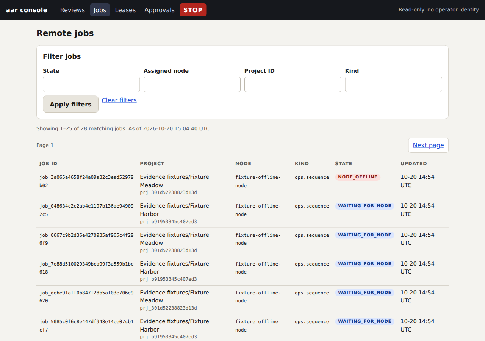
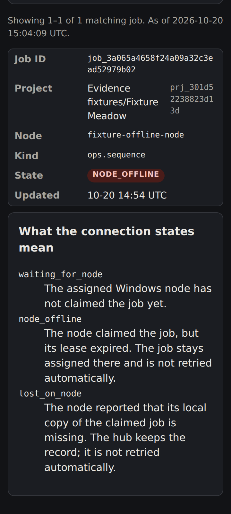

# Linux / Windows workflow verification

The Linux hub owns durable jobs and source media. The Windows node runs Resolve operations
after validating its claim, project, presence, branch ownership and approval. These checks
exercise that split without a live Resolve installation or production data.

## Integrated checkpoint

At commit `1ec6b695d08f419a258548c684120f50bbd37ce8`:

| Check | Result |
| --- | --- |
| Local `make check`, Python 3.12 | Ruff lint and format passed; 4,779 tests passed, 22 skipped |
| GitHub Actions, Linux / Python 3.11 | 4,779 passed, 22 skipped |
| GitHub Actions, Linux / Python 3.12 | 4,779 passed, 22 skipped |
| GitHub Actions, Windows / Python 3.12 node suite | 903 passed, 3 skipped, 6 live tests deselected |

The [Actions run](https://github.com/awtprod/ai-agent-resolve/actions/runs/39444730180)
contains the logs and JUnit artifacts. Independent review subsequently found an in-flight
shutdown checkpoint defect, a nonterminal cancellation of unclaimed work, and malformed
CLI project-input handling. These green results predate the review corrections and do
not establish readiness by themselves.

## Exercised behavior

- `test_linux_independence.py` generates real audio with ffmpeg, ingests it, deletes the
  original, reopens the hub, decodes and measures the Linux copy, lints an EditPlan, runs
  QA, and retrieves saved plan/QA/review artifacts twice. Network and Resolve access are
  forbidden by the fixture. The tone deliberately fails its loudness target; that
  expected QA result is asserted rather than reported as a quality pass.
- The process acceptance test restarts the hub while work is queued, kills a node process
  during a later step, verifies that another node cannot take the sticky claim, and
  restarts the node with its local journal. Completed steps are not repeated.
- Recovery tests cover lost acknowledgements, stale generations, missing local jobs,
  revoked enrollment, unproven local work, more than 1,000 historical jobs, and paged
  reconciliation larger than a single response.
- The media store checks missing/corrupt copies, inconsistent association sizes, resolved
  filesystem paths, project isolation, and bounded streaming ingestion.

## Browser evidence

The production console was started against a disposable hub containing 28 synthetic jobs,
including one offline claim. It was exercised at 1280 × 900 in light mode and 360 × 800
in dark mode, then restarted against the same database. Filtering, pagination, navigation
away and back, invalid page input, and an empty page were checked. The narrow viewport
had no horizontal document overflow. The empty page displayed `Showing 0–0 of 27` with
a first-page link preserving the filter.

These screenshots use console source from `1ec6b69`; they show generated fixture data.

## Remaining release gates and operating limits

- Required Prism review is separate from this independent review. The repository did
  not have a configured Prism runner or API secret during verification.
- Deployment to the Linux hub and a real Windows/Resolve smoke test were not performed.
  D3 live sandbox writes and D4 multiple Resolve instances retain their human gates.
- Actual host media transfer, transcript models and face models were not exercised by
  this acceptance test. Media staging and render return use the existing verified host
  transfer commands.
- One Resolve instance still serializes hot work. Multiple projects can prepare and run
  cold analysis on Linux. Queue limits remain 10,000 lifetime jobs and 100,000 job events;
  exceeding a limit fails closed. Projection scaling remains the S11p follow-up.
- The feature PR targets `dev`. Promotion to `main` is a separate human-gated PR and must
  include the reviewed feature before it is eligible to merge.
